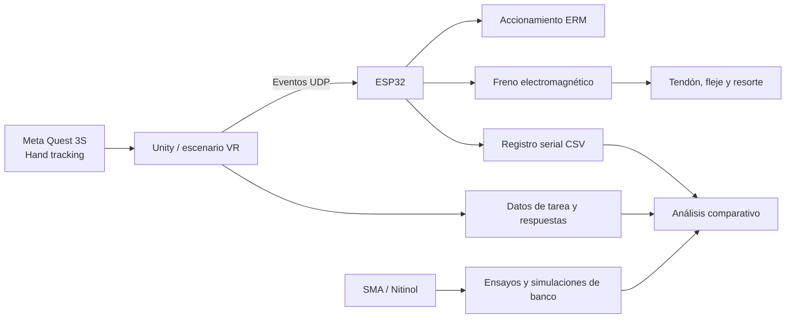

# HAPTIX

**Guante háptico de dos dedos para comparación de actuadores — Tesis de Ingeniería Mecatrónica**

Pontificia Universidad Javeriana · Estado de documentación: **21 de noviembre de 2026** · Versión de repositorio: **v0.0.3 (preparado para publicación)**.

> Proyecto: "Diseño e implementación de un prototipo de guante háptico de dos dedos para la comparación de actuadores hápticos en aplicaciones portátiles". El nombre **HAPTIX** identifica el repositorio; el título académico de la tesis se conserva sin modificaciones.

## Objetivo

Conservar y explicar el desarrollo de un guante háptico de pulgar e índice y los bancos de evaluación de **tres tecnologías**: **motor de masa excéntrica (ERM)**, **freno electromagnético P25/11** y **alambre de Nitinol (SMA)**. El entorno de realidad virtual utiliza seguimiento de manos en Meta Quest 3S, aplicación Unity y comunicación con ESP32. No todas las tecnologías comparten el mismo nivel de integración: la SMA se mantiene como desarrollo/ensayo de banco.

**La documentación no implica que los tres actuadores estén integrados y validados en VR.** El guante físico se documenta como montaje de configuración fija; no se atribuye modularidad no implementada.

## Qué contiene esta versión

| Área | Material realmente incorporado | Estado de verificación |
|---|---|---|
| [Mecánica y CAD](hardware/mecanica/README.md) | Ensamble Fusion `.f3z`, modelos de índice y pulgar `.f3d`, fleje `.f3d` | Originales de Drive; comprobar contra guante fabricado |
| [SMA](simulaciones/sma/README.md) | 2 scripts MATLAB, verificación Python, fundamento y guía | Modelo teórico; sin validación térmica sobre el montaje |
| [P25/11](simulaciones/p25/README.md) | 4 circuitos `.asc`, postproceso MATLAB, CSV y 2 figuras | Procedencia conservada; valores teóricos/hipótesis a distinguir |
| [ERM](simulaciones/erm/README.md) | Script MATLAB y documentación de simulación | Requiere dependencias y verificación de ejecución |
| [Protocolo](protocolo/README.md) | Plantillas de corrida y estructura de pruebas | **No es aún el Excel maestro más reciente** |
| [Análisis CSV](scripts/analizar_corridas.py) | Analizador básico y pruebas unitarias | Pruebas automáticas locales ejecutadas |
| [Firmware ESP32](firmware/esp32/README.md) | Estructura y criterios de integración | Sketch integrado definitivo pendiente de recuperar |
| [Aplicación VR](vr/README.md) | Documentación de arquitectura y problema de hand tracking | Proyecto Unity/APK originales pendientes de recuperar |

Se incorporaron **20 archivos reales de Drive sin modificar sus bytes**. Para cada uno consta SHA-256 y origen en [el registro de importaciones](docs/importaciones_2026-11-21.csv). Los originales de Drive son la referencia principal.

## Arquitectura del sistema



Diagrama **conceptual**, no diagrama eléctrico ni evidencia de que la cadena funciona en el montaje actual. Persisten dificultades de reconocimiento de la mano con el guante instalado.

## Estado de publicación

Este ZIP contiene un **repositorio Git local** listo para publicar, pero **aún no existe** el repositorio remoto en GitHub. La ruta de publicación está documentada en [Publicar HAPTIX desde GitHub Desktop](docs/publicar.md).

## Accesos rápidos

- [Estado y pendientes](docs/estado.md) · [Estado de publicación](docs/estado-publicacion.md) · [Plan de acción](docs/plan-accion.md) · [Backlog](docs/issues-iniciales.md)
- [Actuadores](docs/actuadores/index.md) · [Arquitectura](docs/arquitectura.md)
- [Electrónica/PCB](docs/electronica.md) · [Mecánica](docs/mecanica.md)
- [Protocolo de pruebas](protocolo/README.md) · [Datos](datos/README.md)
- [Inventario de fuentes](docs/fuentes.md) · [Publicar en GitHub](docs/publicar.md)

## Ejecutar herramientas auxiliares

```bash
python -m unittest discover -s tests
python scripts/analizar_corridas.py --carpeta RUTA_DE_CSV --salida resumen.json
```

Las simulaciones MATLAB y los esquemas LTspice **no se han ejecutado de nuevo durante esta importación**. Sus instrucciones originales están incluidas en cada carpeta; el resultado de un modelo no debe describirse como medida experimental.

## Próximos hitos y política

1. Recuperar el proyecto `VRRoom_fuente_20261118_1121.zip`, el sketch `ESP_UDP_receptor(1).ino` y el protocolo Excel maestro del 21-11-2026.
2. Comprobar versiones de firmware, bibliotecas, pines físicos y formatos de mensajes; probar integración ERM/freno.
3. Auditar las revisiones de PCB, consolidar resultados y adjuntar los ensayos de participantes **solo en formatos anonimizados y autorizados**.
4. Comparar los CAD incorporados con el prototipo real antes de etiquetarlos como finales.

**Privado por defecto.** No divulgar claves Wi-Fi, datos de participantes, consentimientos, material de terceros ni prototipos sin revisión. [Política de seguridad](SECURITY.md). Las licencias del proyecto están pendientes.

Consulta también las [decisiones de alcance](docs/decisiones-proyecto.md).
