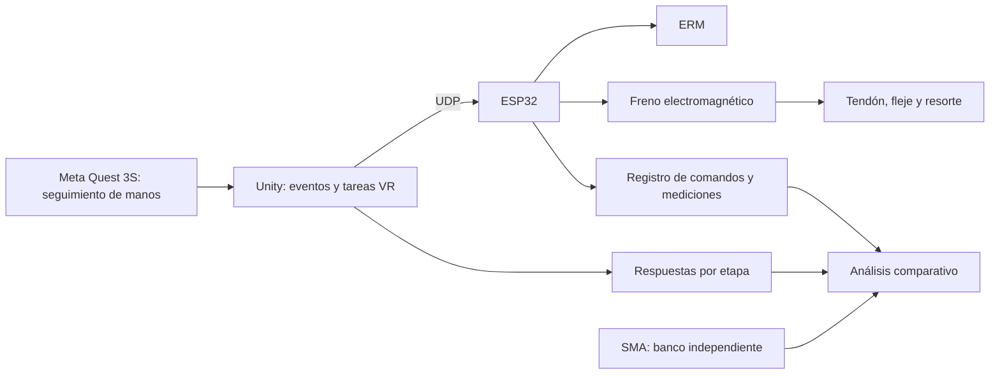

# HAPTIX

**Diseño e implementación de un prototipo de guante háptico de dos dedos para la comparación de actuadores hápticos en aplicaciones portátiles**

Proyecto de grado · Ingeniería Mecatrónica · Pontificia Universidad Javeriana.

> **Estado:** repositorio de trabajo en desarrollo. Los archivos de simulación, diseños CAD y documentación se encuentran en distintos grados de verificación. La existencia de un archivo no demuestra que una prueba se haya ejecutado o aprobado.

## ¿Qué es HAPTIX?

HAPTIX documenta un prototipo de guante háptico para **pulgar e índice**, su electrónica, mecánica, aplicación de realidad virtual y evaluación comparativa de tres tecnologías:

- **ERM:** motores de masa excéntrica para estímulos vibratorios.
- **Freno electromagnético P25/11:** resistencia al movimiento mediante tendón, fleje y resorte de retorno.
- **SMA/Nitinol:** estudio electrotérmico y ensayos de banco; **no se declara integración validada al guante**.

El sistema VR utiliza Meta Quest 3S, seguimiento de manos, Unity, comunicación UDP y ESP32. Hay un problema abierto de reconocimiento de mano con el guante físico, por lo que no se declara validación integral cerrada.

## Ir directamente a los ensayos

**[Protocolo de pruebas: índice general](protocolo/README.md)**

| Parte | Documentación disponible |
|---|---|
| ERM | [Procedimientos E-ERM-01 a E-ERM-08 y antecedentes](protocolo/erm/README.md) |
| Freno electromagnético | [Caracterización eléctrica y mecánica](protocolo/electromagnetico/README.md) |
| SMA | [Ensayos de banco: resistencia, temperatura, fuerza y desplazamiento](protocolo/sma/README.md) |
| Entorno virtual | [Pruebas UDP, hand tracking y respuestas de las tareas](protocolo/vr/README.md) |
| Evidencias | [Cómo relacionar una corrida con su fuente](protocolo/trazabilidad-de-evidencias.md) |
| Comparación | [Criterios para evaluación de actuadores](docs/criterios-comparacion.md) |

**Importante:** el Excel maestro `Protocolo_Pruebas_Guante_Haptico_COMPLETO_FINAL_20261121(1).xlsx` todavía **no ha sido importado ni auditado** aquí. Los documentos anteriores son una consolidación preliminar y **no sustituyen** ese original.

## Otros materiales ya incorporados

- [Diseño mecánico y CAD](hardware/mecanica/README.md): ensamble Fusion, piezas de pulgar/índice y fleje; verificar coincidencia con el prototipo fabricado.
- [SMA — MATLAB y teoría](simulaciones/sma/README.md): scripts, verificación numérica y limitaciones.
- [P25/11 — LTspice y MATLAB](simulaciones/p25/README.md): circuitos, postproceso, CSV y figuras de simulación.
- [ERM — simulación](simulaciones/erm/README.md): script MATLAB y guía de origen.
- [Firmware ESP32](firmware/esp32/README.md) y [entorno VR](vr/README.md): estructura documental; fuentes finales pendientes.
- [Registro de importaciones de Drive con SHA-256](docs/importaciones_2026-11-21.csv): 20 archivos originales conservados byte a byte en la migración inicial.

## Arquitectura conceptual

Es un esquema funcional de referencia, no una prueba de integración completa.

## Reproducibilidad y cautelas

No confundir simulaciones con mediciones. Las pruebas de fuerza, desplazamiento, temperatura y corriente requieren archivos originales, condiciones, instrumentos e incertidumbre. No se publican identificadores personales de participantes ni claves Wi-Fi. Antes de cambiar la visibilidad a pública hay que revisar permisos y derechos de material CAD, código y datos.

- [Estado del proyecto](docs/estado.md)
- [Fuentes y procedencia](docs/fuentes.md)
- [Plan de acción](docs/plan-accion.md)
- [Política de seguridad](SECURITY.md)

**Repositorio GitHub:** https://github.com/Juanleon-19/HAPTIX  
**Estado de visibilidad observado el 21-11-2026:** privado; el propietario puede invitar colaboradores o cambiar la visibilidad en Settings.
