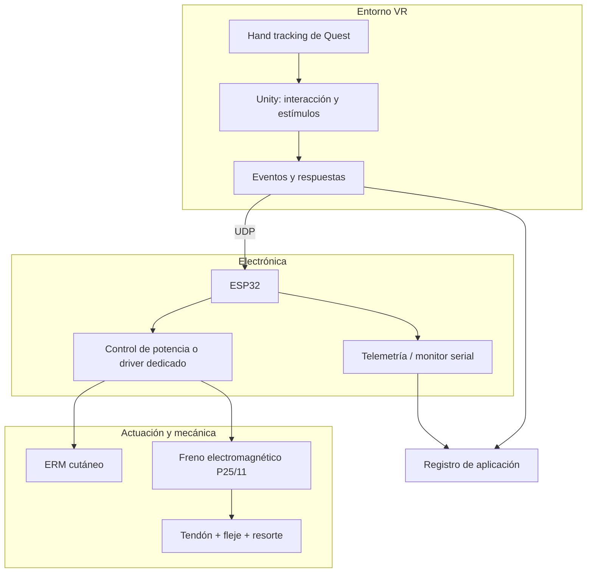

# Arquitectura del sistema

## Alcance

- Dispositivo para **pulgar e índice** con montaje físico de configuración fija.
- Seguimiento de la mano desde las gafas; Unity genera eventos de interacción.
- Comunicación **UDP** con ESP32; el firmware transforma los mensajes en señales apropiadas para la etapa de potencia o el driver háptico.
- Captura de registros de aplicación/ESP32 para comparar actuadores.

## Flujo conceptual

**No es un esquema de conexiones.** Para cada tecnología se requiere su driver real y su tabla de pines. El modelo SMA se ejecuta por separado como estudio de banco.

## Restricciones vigentes

1. La geometría final y el guante actual pueden **ocultar la mano** al *hand tracking*: no calificar el seguimiento como cerrado/validado mientras persista el problema.
2. No indicar que el guante es modular, que los dedales son desmontables o que se reposicionan libremente.
3. La realimentación de seguimiento **no demuestra por sí sola** un controlador de fuerza en lazo cerrado; documentar por separado variable medida, referencia y actuador.
4. El ERM puede ser accionado mediante MOSFET o driver háptico dependiendo del montaje; no unir ambos caminos como si fueran un mismo circuito verificado.
5. SMA fuera del contacto con participantes hasta validar temperatura, aislamiento, alimentación y protección.

## Documentos por consolidar

- Formato real de los paquetes UDP, campos, unidad, orden de bytes y tasas.
- Asignación de pines de cada PCB y revisión cruzada con código.
- Registro con sello temporal y reglas de sincronización de Unity y ESP32.
- Capturas de la escena y del montaje de VR que evidencien la interacción real.
