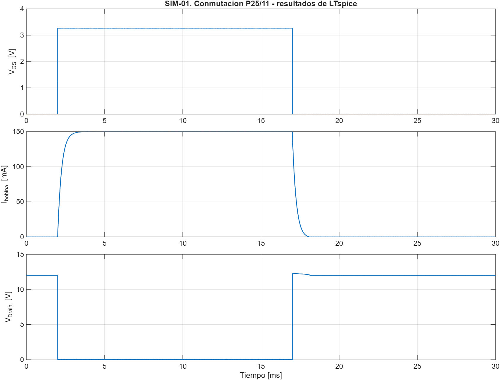
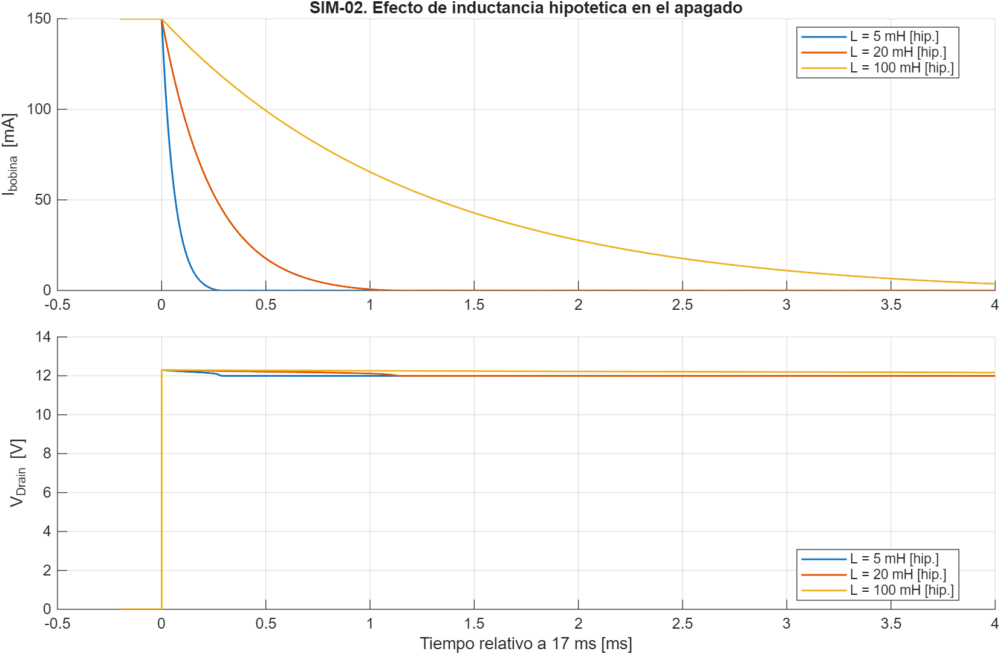

# P25/11: LTspice, MATLAB y gráficas

**Importados realmente desde Drive**: `ltspice/01..04_*.asc`, `matlab/Procesar_P25_LTspice_RAW.m`, `resultados/Tabla_Resultados_P25.csv`, `figuras/F01_*.png`, `figuras/F02_*.png` y `README_ORIGEN.md`.

Los `.raw` originales **no están dentro del ZIP**, porque son archivos binarios de simulación voluminosos disponibles en Drive. El script MATLAB puede necesitar esos `.raw` para reproducir gráficas; no suponemos que las dos figuras incluidas puedan regenerarse con solo el CSV.

*Figura importada de Drive, no medición experimental del electroimán.*

*Figura importada de Drive; inductancias de barrido hipotéticas.*

**Precaución:** el circuito opcional con diodo/Zener es un estudio exploratorio; no lo adoptar como protección definitiva sin validar límites del MOSFET y transitorios.
